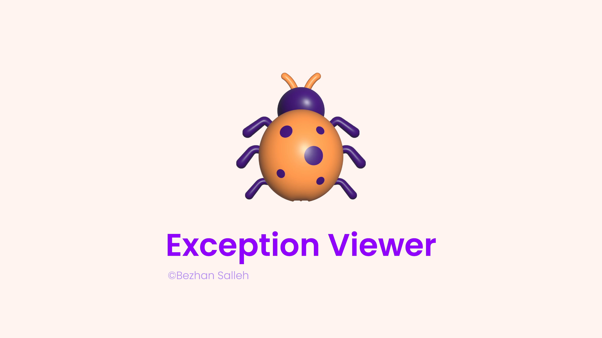

<a href="https://github.com/bezhanSalleh/filament-exceptions" class="filament-hidden">

</a>

<p align="center" class="flex items-center justify-center">
    <a href="https://filamentphp.com/docs/4.x/introduction/overview">
        
    </a>
    <a href="https://filamentphp.com/docs/5.x/introduction/overview">
        
    </a>
    <a href="https://packagist.org/packages/bezhansalleh/filament-exceptions">
        
    </a>
    <a href="https://github.com/bezhansalleh/filament-exceptions/actions?query=workflow%3Arun-tests+branch%3Amain" class="filament-hidden">
        
    </a>
    <a href="https://github.com/bezhansalleh/filament-exceptions/actions/workflows/fix-php-code-style-issues.yml?query=branch%3Amain" class="filament-hidden">
        
    </a>

<a href="https://packagist.org/packages/bezhansalleh/filament-exceptions">
    
    </a>
</p>

# Exception Viewer

A simple and beautiful exception viewer for Filament Panels. The plugin records every exception your app throws and lets you browse, inspect and prune them from inside the panel.

<div class="filament-hidden">
<b>Table of Contents</b>

- [Installation](#installation)
- [Recording Control](#recording-control)
  - [Stop and Start Recording](#stop-and-start-recording)
  - [Conditional Recording](#conditional-recording)
- [Configuration Options](#configuration-options)
  - [Navigation](#navigation)
  - [Labels and Search](#labels-and-search)
  - [Mass Pruning](#mass-pruning)
  - [Tenancy](#tenancy)
  - [General](#general)
- [Custom Exception Model](#custom-exception-model)
- [Translations](#translations)
- [Testing](#testing)
- [Version Support](#version-support)
- [Changelog](#changelog)
- [Contributing](#contributing)
- [Security Vulnerabilities](#security-vulnerabilities)
- [Credits](#credits)
- [License](#license)
</div>

## Installation

1. Install the package with Composer:

```bash
composer require bezhansalleh/filament-exceptions
```

2. Publish and run the migration:

```bash
php artisan exceptions:install
```

3. Register the plugin in your panel provider:

```php
public function panel(Panel $panel): Panel
{
    return $panel
        ->plugins([
            \BezhanSalleh\FilamentExceptions\FilamentExceptionsPlugin::make()
        ]);
}
```

That's it. The package hooks into Laravel's exception handler and starts recording exceptions right away.

> [!IMPORTANT]
> The plugin follows Filament's theming rules. Create a custom theme if you haven't already, then add the following line to your `theme.css` file:

```css
@source '../../../../vendor/bezhansalleh/filament-exceptions/resources/views/**/*.blade.php';
```

Then build your theme:

```bash
npm run build
```

## Recording Control

The plugin records exceptions by default. Control that behavior from the `boot()` method of your `AppServiceProvider`.

### Stop and Start Recording

```php
use BezhanSalleh\FilamentExceptions\FilamentExceptions;

public function boot(): void
{
    // Stop recording exceptions
    FilamentExceptions::stopRecording();

    // Resume recording
    FilamentExceptions::startRecording();

    // Check whether recording is active
    FilamentExceptions::isRecording();
}
```

### Conditional Recording

Call `recordUsing()` to decide, per exception, whether the plugin records it:

```php
use BezhanSalleh\FilamentExceptions\FilamentExceptions;

public function boot(): void
{
    // Record only in production
    FilamentExceptions::recordUsing(fn () => app()->isProduction());

    // Skip specific exception types
    FilamentExceptions::recordUsing(function (Throwable $e) {
        return ! $e instanceof \Illuminate\Validation\ValidationException
            && ! $e instanceof \Illuminate\Auth\AuthenticationException;
    });

    // Combine several conditions
    FilamentExceptions::recordUsing(function (Throwable $e) {
        if (! app()->isProduction()) {
            return false;
        }

        // Skip 4xx HTTP exceptions
        if ($e instanceof \Symfony\Component\HttpKernel\Exception\HttpException
            && $e->getStatusCode() < 500) {
            return false;
        }

        return true;
    });
}
```

## Configuration Options

Chain any of the following methods onto the plugin when you register it.

### Navigation

```php
FilamentExceptionsPlugin::make()
    ->navigationBadge(bool | Closure $condition = true)
    ->navigationBadgeColor(string | array | Closure $color)
    ->navigationGroup(string | Closure | null $group)
    ->navigationParentItem(string | Closure | null $item)
    ->navigationIcon(string | Closure | null $icon)
    ->activeNavigationIcon(string | Closure | null $icon)
    ->navigationLabel(string | Closure | null $label)
    ->navigationSort(int | Closure | null $sort)
    ->registerNavigation(bool | Closure $shouldRegisterNavigation)
    ->subNavigationPosition(SubNavigationPosition | Closure $position)
```

### Labels and Search

```php
FilamentExceptionsPlugin::make()
    ->modelLabel(string | Closure | null $label)
    ->pluralModelLabel(string | Closure | null $label)
    ->titleCaseModelLabel(bool | Closure $condition = true)
    ->globallySearchable(bool | Closure $condition = true)
```

### Mass Pruning

```php
FilamentExceptionsPlugin::make()
    ->modelPruneInterval(CarbonInterface $interval)
```

> [!NOTE]
> Pruning runs through Laravel's scheduler, so make sure you have it [running](https://laravel.com/docs/scheduling#running-the-scheduler).

### Tenancy

```php
FilamentExceptionsPlugin::make()
    ->scopeToTenant(bool | Closure $condition = true)
    ->tenantOwnershipRelationshipName(string | Closure | null $ownershipRelationshipName)
    ->tenantRelationshipName(string | Closure | null $relationshipName)
```

### General

```php
FilamentExceptionsPlugin::make()
    ->cluster(string | Closure | null $cluster)
    ->slug(string | Closure | null $slug)
```

A combined example:

```php
return $panel
    ->plugins([
        FilamentExceptionsPlugin::make()
            ->navigationLabel('Error Logs')
            ->navigationIcon('heroicon-o-bug-ant')
            ->navigationBadge()
            ->navigationGroup('System')
            ->modelPruneInterval(now()->subDays(7))
    ]);
```

## Custom Exception Model

1. Extend the base model:

```php
<?php

namespace App\Models;

use BezhanSalleh\FilamentExceptions\Models\Exception as BaseException;

class MyCustomException extends BaseException
{
    ...
}
```

2. Register it in the `boot()` method of a service provider, for example `AppServiceProvider`:

```php
use App\Models\MyCustomException;
use BezhanSalleh\FilamentExceptions\FilamentExceptions;
...
   public function boot()
   {
       FilamentExceptions::model(MyCustomException::class);
   }
...
```

## Translations

Publish the translations:

```bash
php artisan vendor:publish --tag=filament-exceptions-translations
```

## Testing

```bash
composer test
```

## Version Support

Only the latest major plugin line receives active development. Older lines stay installable for legacy projects but get no new features; they only receive security fixes while their Filament target is still supported upstream.

| Plugin | Filament | Status |
|---|---|---|
| **[`4.x`](https://github.com/bezhansalleh/filament-exceptions/tree/main)** | [v4](https://filamentphp.com/docs/4.x/introduction/overview) & [v5](https://filamentphp.com/docs/5.x/introduction/overview) | **Active** — new features + bug fixes (lives on `main`) |
| [`3.x`](https://github.com/bezhansalleh/filament-exceptions/tree/3.x) | [v3](https://filamentphp.com/docs/3.x/panels/installation) | End of life — follows Filament v3 EOL |
| [`2.x`](https://github.com/bezhansalleh/filament-exceptions/tree/2.x) | [v3](https://filamentphp.com/docs/3.x/panels/installation) | End of life — follows Filament v3 EOL |
| [`1.x`](https://github.com/bezhansalleh/filament-exceptions/tree/1.x) | [v2](https://filamentphp.com/docs/2.x/admin/installation) | End of life |

See [CHANGELOG](CHANGELOG.md) for migration notes between majors.

## Changelog

See [CHANGELOG](CHANGELOG.md) for the list of recent changes.

## Contributing

See [CONTRIBUTING](.github/CONTRIBUTING.md) for details.

## Security Vulnerabilities

Review [our security policy](../../security/policy) to learn how to report security vulnerabilities.

## Credits

- [Bezhan Salleh](https://github.com/bezhanSalleh)
- [All Contributors](../../contributors)

## License

The MIT License (MIT). See the [License File](LICENSE.md) for more information.
